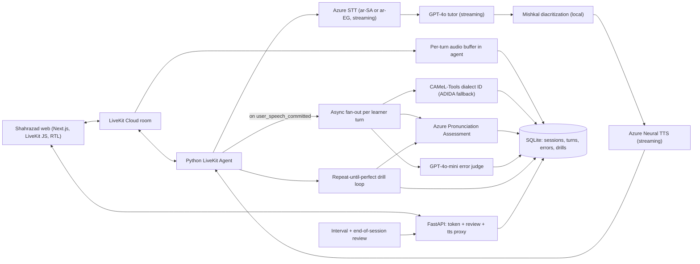
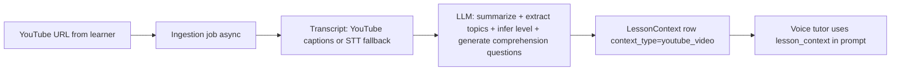

# Shahrazad — MSA Voice Tutor (V1)

**Shahrazad** (شهرزاد) is a full-duplex MSA Arabic voice tutor. The learner speaks MSA; the tutor speaks MSA back; every learner turn is silently analyzed in parallel; errors are stored; and the learner is corrected through a repeat-until-perfect drill loop with interval and end-of-session review.

This plan merges three sources: my cascade/pedagogy plan, ABLA (content + dialect ideas), and a second agent's LiveKit-based plan. Decisions locked with the user: cloud APIs, web MVP, both pronunciation and grammar/vocab errors, **LiveKit Agents** as the voice backbone, the **repeat-until-perfect drill loop + interval review kept in V1 core**, and the product name **Shahrazad**.

## Product identity

| Field | Value |
|-------|-------|
| **Product name (EN)** | Shahrazad |
| **Product name (AR)** | شهرزاد |
| **Repo / monorepo root** | `shahrazad/` |
| **Backend package** | `shahrazad-agent/` |
| **Frontend app** | `shahrazad-web/` |
| **Subtitle (EN)** | MSA voice tutor |
| **Subtitle (AR)** | مدرب المحادثة بالفصحى |
| **LiveKit room prefix** | `shahrazad-` |

**Why Shahrazad:** Scheherazade survives by **telling stories and asking questions** — the same loop as a tutor who keeps the conversation alive while checking comprehension. The name maps cleanly to V1 (topic conversations) and Phase 2 (YouTube → summary → comprehension Q&A). It reads as literary and adult without sounding like a kids' app.

**Alternatives considered (not chosen):** Fahm (comprehension, less narrative); Adeeb (MSA prestige, collision with Adeeb Kids edtech); Hudhud (rejected — Yalla Hudhud voice Arabic AI collision).

**Brand notes for implementation:**
- Tutor persona in prompts: a patient MSA conversation partner who **draws the learner out with questions** (Shahrazad framing), not a drill sergeant.
- UI wordmark: **Shahrazad** in LTR contexts; **شهرزاد** in RTL header when locale is Arabic.
- Avoid "Shahrzad" spelling in code/repo (use **Shahrazad** consistently in EN identifiers; AR strings use شهرزاد).
- SEO noise from unrelated "Shahrazad" apps (e.g. Tehran super-app) is acceptable; subtitle "MSA voice tutor" disambiguates in store/listing copy later.

## Why this architecture (vs PersonaPlex / ABLA)

- **PersonaPlex-7B** (full-duplex S2S, Moshi/Helium/Mimi): great feel, but English-only and a black box (no transcript, no error analysis). PR #59 proves even NVIDIA drops to a cascade for new languages. Not usable as the core.
- **ABLA** (aiXplain hackathon): text-only chatbot (GPT-4o + MT + dialect classifier + poetry RAG). No ASR, no error/pronunciation loop. It is the content layer, not the voice loop. We borrow its dialect-classifier idea (implemented via CAMeL-Tools rather than ADIDA) and MT/RAG ideas.
- **Our approach**: a cascade (STT -> LLM -> TTS) gives the text artifacts a tutor needs, wrapped in LiveKit for full-duplex feel (VAD, barge-in, turn-taking) without hand-rolled audio plumbing.

## Stack (final for V1)

- **Voice backbone**: LiveKit Agents (`livekit-agents`, `livekit-plugins-azure`, `livekit-plugins-openai`); LiveKit Cloud free tier for V1.
- **STT**: Azure Speech streaming, `ar-SA` (fallback `ar-EG`), Detailed output for word timings.
- **LLMs**: GPT-4o for tutor turns (note: GPT-4o is grandfathered/legacy for existing OpenAI accounts as of 2026; new accounts default to GPT-4.1 family at ~$5/$15 per 1M tokens — use GPT-4.1 or GPT-4.1-mini as the modern equivalent if GPT-4o is unavailable); GPT-4o-mini (or GPT-4.1-mini) for the grammar/vocab error judge (cost).
- **TTS**: Azure Neural Arabic (`ar-SA-HamedNeural` male / `ar-SA-ZariyahNeural` female), streaming; barge-in via LiveKit.
- **Diacritization (tashkeel)**: **Mishkal** (local pip package, no API key). Farasa was skipped in Phase 0 (no QCRI account). Runs on tutor reply text and drill reference text **before** TTS so Azure neural voices pronounce MSA correctly. Runs concurrently with LLM streaming to hide latency (see Latency budget below).
- **Pronunciation scoring**: `azure-cognitiveservices-speech` Pronunciation Assessment used directly (the LiveKit plugin doesn't expose it). **Locale decision: run PA in the same locale as STT** — verify in spike whether `ar-SA` PA returns usable word-level scores (research says phoneme fields empty but word-level may work); if not, run **both STT and PA in `ar-EG`** to avoid reference/engine locale mismatch. Do NOT mix STT `ar-SA` + PA `ar-EG` (transcript-as-reference trick breaks across locales). For Arabic, rely on word-level accuracy/fluency/completeness (no reliable phoneme breakdown today).
- **Dialect drift**: **GPT-4o-mini judge (primary)** — the grammar/vocab judge also flags dialect/register lexical choices (e.g. عايز/بدي vs أريد) per turn. **CAMeL-Tools `DialectIdentifier` runs as a corroborating signal only** — Phase 0 spike showed its 26-way city model assigns P(MSA) ≈ 0.0001 even to clean MSA sentences, so probability thresholds on it cannot be the primary detector. Re-evaluate CAMeL thresholds on real learner audio in Phase 2; ADIDA fallback dropped unless evidence demands it.
- **Per-turn audio capture**: buffer learner audio **in the agent** on `user_speech_committed` (VAD segment already processed by STT), write WAV to local FS/S3, path on `Turn.audio_path` and `ErrorEntry.learner_audio_path`. Do NOT rely on LiveKit room egress for per-turn clips (egress is for full-track/session backup). Retention configurable; default 30 days + deletion job. Consent banner in onboarding.
- **Backend/API**: FastAPI for LiveKit JWT token + review endpoints; SQLAlchemy + SQLite (Postgres-ready schema).
- **Frontend**: Next.js (App Router), `@livekit/components-react`, `next-intl` (AR/EN), `dir="rtl"` for Arabic, Tailwind.

## Architecture




Two invariants:

1. **Response path is fast.** STT -> LLM -> Tashkeel -> TTS is one streaming chain in `livekit-agents` (target 600-900 ms end-to-end). Diacritization runs **concurrently with LLM streaming**: as LLM emits sentence chunks, tashkeel is applied per-chunk before sending to TTS, hiding most of its ~100–300ms latency. Note: the *first* sentence still serializes (LLM first sentence -> tashkeel -> TTS), so tashkeel latency directly affects TTFB — hence the fallback rule below.
2. **Error capture never blocks.** Detectors run as background `asyncio.create_task(...)` off `user_speech_committed`, writing to SQLite and emitting LiveKit data messages.
3. **Tashkeel never breaks the conversation.** Mishkal runs locally with no SLA concerns, but model load can exceed 300ms on cold start — **warm the engine at worker startup**. Rule: **300ms timeout per chunk -> send undiacritized text to TTS** (degraded pronunciation beats a stalled conversation). Cache diacritized outputs keyed by text hash — drill phrases repeat by design, so the cache pays for itself immediately.

### Latency budget (tutor turn, target p50 < 800ms)

| Stage | Est. p50 |
|-------|----------|
| Azure STT final transcript (learner end-of-turn) | ~150–250ms |
| GPT-4o first token (streaming, with prompt cache) | ~200–400ms |
| Tashkeel per sentence chunk (parallel with LLM stream) | ~100–200ms (hidden) |
| Azure Neural TTS time-to-first-audio | ~200–350ms |
| LiveKit WebRTC transport to browser | ~50–100ms |
| **End-to-end perceived** | **~600–900ms** |

If Azure STT or TTS pushes past budget in the spike, fallbacks: Deepgram Nova-3 STT (sub-300ms) and/or Cartesia Sonic 3.5 TTS (~128ms TTFB).

## Error taxonomy (the differentiator)

Each learner turn yields zero or more `ErrorEntry` rows:

```python
class ErrorEntry:
    id: str
    session_id: str
    turn_id: str
    kind: Literal["pronunciation", "dialect_drift", "grammar", "vocabulary"]
    severity: Literal["info", "minor", "major"]
    learner_text: str
    learner_audio_path: str | None
    correct_form: str
    explanation_ar: str
    explanation_en: str
    detector: Literal["azure_pa", "camel_tools", "adida", "llm_judge"]
    score: float | None
    acknowledged_at: datetime | None
    resolved_at: datetime | None    # set when a drill succeeds
    created_at: datetime

class DrillAttempt:
    id: str
    session_id: str
    error_entry_id: str | None   # nullable for proactive drills not tied to an error
    target_text: str             # diacritized reference the learner is repeating
    attempt_number: int
    accuracy_score: float | None
    completeness_score: float | None
    fluency_score: float | None
    passed: bool
    learner_audio_path: str | None
    created_at: datetime

class Turn:
    id: str
    session_id: str
    speaker: Literal["learner", "tutor"]
    text: str                    # STT transcript or tutor reply (may be undiacritized)
    audio_path: str | None       # learner turn WAV buffered in agent (not LiveKit room egress)
    turn_index: int
    created_at: datetime

class LessonContext:
    """Injectable conversation ground — V1 uses preset topics; Phase 2 adds YouTube."""
    id: str
    session_id: str
    context_type: Literal["preset_topic", "youtube_video"]  # Phase 2 adds youtube_video
    # V1 preset_topic payload: { "topic_id", "title_ar", "title_en", "level_hint", "key_vocab": [], "comprehension_goals": [] }
    # Phase 2 youtube_video payload: { "video_id", "url", "title", "transcript", "summary_ar", "summary_en", "inferred_level", "key_topics": [], "comprehension_questions": [] }
    context_payload: dict        # JSON; validated per context_type
    created_at: datetime
```

Detection sources:

- **pronunciation** -> Azure PA per word (transcript as reference, `EnableMiscue=False`); flag accuracy < 70 or completeness < 80. **Known limitation (circularity):** if the learner mispronounces a word badly enough that STT hears a *different* word, PA scores the audio against the misheard word and reports high accuracy — so conversational PA systematically misses the worst errors. Treat free-conversation PA hits as low-confidence signals; **drills are the source of truth for pronunciation** (reference text is the known target, not the transcript).
- **dialect_drift** -> **GPT-4o-mini judge (primary)**: the per-turn judge flags dialect lexical items and register slips with the same strict-JSON schema (`kind="dialect_drift"`). CAMeL-Tools runs alongside as a corroborating signal; log its scores to `ErrorEntry.score` but do not create errors from CAMeL alone (Phase 0 spike: P(MSA) ≈ 0.0001 on clean MSA — 26-way city model is unusable as a threshold detector on short sentences). Revisit with real learner audio in Phase 2.
- **grammar / vocabulary** -> GPT-4o-mini judge returning strict JSON (case endings, agreement, idafa, definiteness, register). **Known limitation:** streaming STT language models normalize some learner grammar errors (wrong case endings, agreement) before the judge sees the text — the judge can only catch what survives transcription. If judge recall looks low in testing, try Detailed/lexical output and NBest comparison.

## Live response path (tutor turn)

LiveKit pipeline = Azure STT (streaming, same locale as PA per spike decision) -> GPT-4o (MSA tutor prompt + **injectable `lesson_context`** + last ~8 turns + brief running error summary) -> Mishkal tashkeel on streamed chunks -> Azure TTS streaming. Tutor prompt rules:

- Reply in vocalized MSA (tashkeel on new vocab and any word mispronounced last turn).
- **Recast-style** gentle correction mid-conversation; explicit corrections live in review, not interrupting flow.
- Stay on topic; short open questions; ~25 words/turn max.
- **Shahrazad persona:** curious, patient interlocutor who asks follow-up questions to keep the learner talking (comprehension-through-dialogue), not lecture mode.

**Race condition handling for the running error summary:** errors from turn N are written by async fan-out and may not be ready when the tutor prompt for turn N+1 is built. The tutor prompt uses only errors from turns ≤ N-2 (guaranteed committed); turn N-1's errors may appear in the following summary. This keeps the response path non-blocking while still letting the tutor reinforce weak points.

## Repeat-until-perfect drill loop (V1 CORE)

Directly addresses the user's "ask him to repeat and listen until he perfects it":

1. Tutor speaks the target word/phrase (TTS, diacritized via tashkeel layer).
2. Learner repeats; Azure PA scores against the target reference (same locale as STT).
3. If accuracy >= threshold -> praise, mark linked `ErrorEntry.resolved_at`, exit.
4. Else -> targeted corrective feedback, increment attempt, loop (cap at max attempts to avoid frustration, then defer).
5. Every attempt persisted as a `DrillAttempt` row.

**Drill-mode mechanics (LiveKit config):** drills are rapid short turns, so use a shorter endpointing silence timeout (~700–1000ms vs ~1200–1500ms for free conversation) and disable barge-in on the tutor's model-phrase playback so the learner can't interrupt the reference audio. Re-enable barge-in during the learner's repeat phase.

**Contingency — if Azure PA word-level scores are unusable in both `ar-SA` and `ar-EG` (spike outcome):** the drill loop ships anyway with degraded scoring: (a) STT the learner's repeat and score by normalized text match against the target (word-level edit distance, tashkeel-stripped); (b) GPT-4o-mini compares transcript vs target and generates the corrective feedback; (c) `DrillAttempt.accuracy_score` stores the text-match ratio and a `scoring_mode` flag distinguishes `azure_pa` from `text_match` rows so V2 can recalibrate. Strict phoneme-level scoring is deferred to Harf-Speech when it ships. This keeps the core loop (speak -> repeat -> feedback -> repeat) intact regardless of the spike result.

## Interval review (V1 CORE)

Every N learner turns (default N=8, configurable) or on learner command, the tutor pauses the conversation, surfaces accumulated **unresolved** errors, runs drills on the most severe, then resumes the topic. End-of-session review shows the full list.

**Pause mechanics:** during interval review, the LiveKit agent sets `interruption_mode = "drill"` which (a) raises the endpointing threshold so the tutor's review speech isn't interrupted by learner backchannels, and (b) gates STT submission until the tutor explicitly hands the turn back ("your turn — repeat after me"). Resuming the topic restores normal free-conversation mode.

## Review screen

`GET /sessions/:id/errors` (grouped by kind). Each `ErrorReviewCard`:

- `learner_text` (RTL) + playback of original learner audio (if stored).
- `correct_form` + Azure TTS play button (cached via `/tts` proxy).
- `explanation_ar` + collapsible `explanation_en`.
- Drill history + Acknowledge button (`acknowledged_at`, used by V2 SRS).

## Optional enhancements from ABLA

- **Dialect-drift detection** -> promoted to CORE (`dialect_core` todo): coach learner toward MSA when they slip into dialect.
- **MT scaffolding** (optional): on-demand EN<->AR translation tool.
- **Content RAG** (optional): graded MSA content index for controlled difficulty (not ABLA's poetry corpus). Shares infrastructure with Phase 2 YouTube context (see below).
- Not adopting: aiXplain as the backbone (lock-in, weak fit for the streaming voice + scoring loop).

## Phase 2 (planned): YouTube-grounded conversations

**User story (Shahrazad mode):** Learner shares a YouTube URL (e.g. a greetings lesson, a news clip, or a movie excerpt). Shahrazad **ingests the story**, extracts what the video teaches, infers difficulty level from content, and runs a **comprehension conversation** — asking questions to verify the learner understood the topics, vocabulary, and ideas in the video. A beginner greetings video → basic MSA Q&A; an advanced news segment → higher-register discussion. This is the natural extension of the Shahrazad brand: every session is "listen, then converse about what you heard."

**Not in V1.** V1 ships preset topic picker only. Phase 1 architecture must make this a plug-in, not a rewrite.

### Phase 2 pipeline (future)



1. Learner pastes URL on session start (or topic picker gains a "From YouTube" tab).
2. Background job fetches metadata + transcript (`youtube-transcript-api` or similar; Whisper on audio if no captions).
3. LLM produces: `summary_ar/en`, `inferred_level` (A1–C1 heuristic), `key_topics[]`, `key_vocab[]`, `comprehension_questions[]` (ordered, increasing difficulty).
4. Stored as `LessonContext` with `context_type="youtube_video"`.
5. Tutor system prompt switches to **comprehension mode**: ask questions from the generated list, follow up on weak answers, still run error fan-out + drills on learner speech. Conversation level follows video content, not a fixed preset.

### V1 foundation hooks (lay now, use in Phase 2)

| Hook | V1 implementation | Phase 2 extension |
|------|-------------------|-------------------|
| **`LessonContext` model** | One row per session; V1 only `context_type="preset_topic"` with static JSON from topic catalog | Add `youtube_video` type + richer payload |
| **`ContextAdapter` interface** | Python protocol: `build_system_prompt_block(lesson_context) -> str` and `get_comprehension_goals() -> list[str]` | Add `YouTubeContextAdapter` alongside `PresetTopicAdapter` |
| **Tutor prompt template** | Single template with `{lesson_context_block}` placeholder; never hardcode topic strings in pipeline | Swap adapter based on `context_type` |
| **Session start API** | `POST /sessions` accepts `{ topic_id }` today | Extend to `{ topic_id \| youtube_url }` without breaking V1 clients |
| **Frontend topic picker** | Preset cards only | Add URL input field + "processing transcript…" state (UI stub optional in V1) |
| **Content store** | Optional small JSON topic catalog in repo | Same store pattern for cached video analyses (video_id dedup) |
| **Error taxonomy** | Unchanged | Add optional `kind="comprehension"` later if tutor tracks missed video concepts separately |

**V1 rule:** every session creates a `LessonContext` row — even preset topics — so the tutor pipeline always reads context through the adapter. Phase 2 adds a second adapter and ingestion job; no pipeline fork.

### Phase 2 dependencies (defer)

- YouTube ToS / transcript availability (captions may be missing → Whisper fallback adds cost).
- Content moderation for user-submitted URLs.
- Async job queue (Redis/Celery or simple background task) for ingestion latency (10–60s before session can start).
- Optional: store video thumbnail + title in review UI for session recall.

## Build phases (recommended order)

```
Phase 0 — Spikes (verify_externals)              block everything
Phase 1 prereq — Python 3.10+ runtime          system Python is 3.8; livekit-agents needs >=3.10 (pyenv or deadsnakes) — spike venv stays on 3.8
Phase 1 — Voice round-trip                     tutor_pipeline + diacritization + scaffold + LessonContext adapter (preset only)
Phase 2 — Error fan-out + DB                   error_fanout + db_layer + dialect_core
Phase 3 — Drill loop                           drill_loop
Phase 4 — Review API + live session UI         review_api + frontend_scaffold + frontend_session
Phase 5 — Interval review + review UI          interval_review + frontend_review
Phase 6 — Polish                               docker_and_readme
——— future ———
Phase 7 — YouTube context (Phase 2 product)    ingestion job + YouTubeContextAdapter + URL UI
```

## Component alternatives research (June 2026)

Deep-dive on each stack choice. Verdict column = recommendation for this project.

| Component | Current choice | Alternatives evaluated | Verdict |
|-----------|---------------|------------------------|---------|
| **Voice backbone** | LiveKit Agents | **Pipecat** (Daily-backed, frame pipeline, max provider swap flexibility); **Vapi/Retell** (managed, hours-to-MVP, platform fee ~$0.05–0.10/min); **Azure Voice Live** (unified S2S WebSocket, Arabic supported); raw FastAPI WebSocket | **Keep LiveKit.** Best WebRTC + barge-in for web; Pipecat is equal if you prefer Daily. Vapi only if you want zero infra and accept lock-in. **Do NOT use Voice Live as primary** — black-box S2S makes error fan-out, PA drills, and transcript logging harder (same problem as PersonaPlex). LiveKit now has an Azure Voice Live plugin if you want hybrid later. |
| **STT** | Azure Speech `ar-SA` streaming | **Deepgram Nova-3** (`ar-SA` + 16 dialects, sub-300ms, strong LiveKit plugin); **Google Chirp 3** (`ar-SA` streaming, preview); **Whisper large-v3** (cheap self-host, ~9–14% WER on Arabic tier-2, weak on dialects); **Gladia** (100+ langs, code-switching) | **Spike Azure vs Deepgram.** aiXplain 2026 dialectal benchmark: Azure lowest WER (~43.5%) but slowest (~23s batch); Whisper cheapest/fastest but worse accuracy. For MSA learners: Azure likely best accuracy + shares account with PA/TTS. Deepgram wins if latency is the bottleneck and LiveKit integration matters. Google Chirp 3 viable third option but adds vendor + `ar-SA` still preview. |
| **TTS** | Azure Neural `ar-SA-HamedNeural` | **Cartesia Sonic 3.5** (sub-128ms TTFB, Arabic listed but Emirati-oriented); **ElevenLabs v2** (most natural MOS, Arabic prosody sometimes off); **Google Neural2/Chirp**; **OpenAI TTS** | **Keep Azure for V1.** Best MSA diacritics handling, full SSML/IPA, pairs with PA. Cartesia worth spiking if Azure TTS latency breaks the 600–900ms target. ElevenLabs only if voice quality > pedagogical tashkeel fidelity. |
| **Diacritization** | *(missing from plan)* | **Mishkal** (local, pip); Farasa (QCRI API); Fine-Tashkeel (ByT5); CATT (SOTA DER) | **V1: Mishkal** — Phase 0 spike ~77–114ms/chunk after warm-up. STT output is undiacritized; tutor TTS and drill reference text need tashkeel before TTS. |
| **Pronunciation scoring** | Azure PA (`ar-EG` locale) | **Harf-Speech** (open, phoneme-level, 0.791 SLP correlation vs Azure 0.53–0.67 — best for Arabic but staging/no public API yet); **SpeechSuper** (8 langs, no Arabic); **SpeechAce** (EN/FR/ES only); **Chivox MCP** (EN/ZH only) | **Keep Azure PA for V1** (word-level only for Arabic; no phoneme fields). **Plan Harf-Speech integration for V2** when code/API is available — this is the single biggest quality upgrade for "repeat until perfect" on ع/غ/ص. No commercial Arabic alternative beats Azure today except unreleased Harf-Speech. |
| **LLM tutor** | GPT-4o | **Claude 3.5 Sonnet** (0.84 F1 on Arabic i'rab parsing vs GPT-4o 0.83); **Gemini 1.5 Pro** (0.77, good tables); **ALLaM 7B/34B** (Arabic-first, Gulf/Khaleeji, sovereign); **Falcon-H1 Arabic** (broad dialect coverage, open) | **Keep GPT-4o** for conversational tutor (Nahw benchmark 67% avg, best on GEC+explanation). Consider **Claude 3.5 for error judge** if grammar/i'rab explanations are weak in testing. ALLaM optional later for Gulf-leaning learners or data-sovereignty — not needed for cloud MVP. |
| **Error judge** | GPT-4o-mini | GPT-4o (cost), Claude Haiku, Gemini Flash | **Keep GPT-4o-mini** for background fan-out cost. Upgrade to GPT-4o or Claude 3.5 only if judge precision is insufficient in spike. |
| **Dialect drift** | LLM judge primary + CAMeL corroboration | **CAMeL-Tools DialectIdentifier** (free, local, 25 city dialects + MSA label — Phase 0 spike: P(MSA)≈0.0001 on clean MSA, unusable as threshold detector alone); **CAMeLBERT-NADI** (HF, 21 country labels); **NADI2024 MarBERT** | **GPT-4o-mini judge is the primary dialect detector** (it already reads every turn); CAMeL logs corroborating scores only. Revisit CAMeL/CAMeLBERT thresholds on real learner audio in Phase 2. ADIDA dropped. |
| **Backend API** | FastAPI | Django, Node/Express | **Keep FastAPI** — best fit for LiveKit agent + async fan-out + review endpoints in one Python codebase. |
| **Database** | SQLite + SQLAlchemy | Postgres, Supabase | **Keep SQLite for V1.** Postgres/Supabase when multi-user or hosted review UI needed. |
| **Frontend** | Next.js + LiveKit React + next-intl | Remix, plain React + Vite | **Keep Next.js** — App Router + RTL/i18n + LiveKit components is the path of least resistance. |
| **Optional MT** | LLM tool | Azure Translator, Google Translate | Either fine; Azure Translator if staying single-vendor. |
| **Optional RAG** | Custom index | pgvector, Chroma, Azure AI Search | Chroma or pgvector for V1 graded MSA content; no strong reason to change. |

**Recommended plan adjustments from this research:**
1. Add **diacritization step** (Mishkal) before TTS — was a gap.
2. **STT spike**: Azure `ar-SA` vs Deepgram Nova-3 `ar-SA` on non-native MSA learner audio (latency + WER).
3. **Dialect classifier**: CAMeL-Tools as primary, ADIDA as fallback.
4. **Pronunciation V2 path**: track Harf-Speech release; do not invest in SpeechAce/SpeechSuper/Chivox (no Arabic).
5. Everything else in current stack holds.

## API subscriptions and cost estimates (June 2026)

### What requires a paid account vs free

| Component | Account needed | Billing model | V1 cost |
|-----------|----------------|---------------|---------|
| **LiveKit Cloud** | Free signup (no card on Build tier) | 1,000 agent-min/month free; then **$0.01/min** | **$0** for solo dev within free tier |
| **Azure Speech** (STT + TTS + PA) | Azure account + pay-as-you-go | STT real-time **~$1/audio hour**; PA billed same as STT; Neural TTS **~$16/1M chars** | Free tier: **5 STT hours + 500k TTS chars/mo** (new accounts, ~12 mo) |
| **OpenAI API** (GPT-4o tutor + 4o-mini judge) | OpenAI account + pay-as-you-go | GPT-4o **~$2.50/M in, $10/M out**; 4o-mini **~$0.15/M in, $0.60/M out** | Usage-only; often **$5 starter credit** for new accounts |
| **Mishkal diacritization** | local pip | Free | **$0** |
| **CAMeL-Tools dialect ID** | pip install | Open source, runs locally | **$0** |
| **FastAPI + SQLite + Next.js** | None | Self-hosted / local | **$0** (local dev) |
| **Optional: VPS hosting** | Hetzner/DigitalOcean/etc. | ~$5–20/mo if deployed | Only if not running locally |
| **Optional: LiveKit Ship** | $50/mo plan | 5,000 agent-min included | Not needed for MVP |
| **Optional: ADIDA, Deepgram, ElevenLabs** | Per vendor | Not in core V1 plan | **$0** unless swapped in |

**No monthly SaaS subscription is strictly required** — everything is pay-as-you-go except optional LiveKit upgrade. You need credit cards on **Azure** and **OpenAI** for real usage beyond free tiers.

### Per-session cost model (15-minute tutor session, after free tiers)

Assumptions: ~20 learner turns; learner speaks ~6 min total; tutor ~25 words/turn; fan-out runs PA + mini judge on every turn; ~3 drill retries in session.

| Line item | Usage | Est. cost |
|-----------|-------|-----------|
| LiveKit agent session | 15 min connected | **$0.15** |
| Azure STT (learner audio) | ~6 min (0.1 hr) | **$0.10** |
| Azure Pronunciation Assessment | ~8 min audio (turns + drills; billed as STT) | **$0.13** |
| Azure Neural TTS | ~2,500–3,500 Arabic chars | **$0.04–0.06** |
| GPT-4o tutor | ~40k in + ~1.5k out tokens | **$0.12** |
| GPT-4o-mini error judge | ~10k in + ~4k out tokens | **$0.004** |
| Mishkal + CAMeL-Tools | local | **~$0** |
| **Total per 15-min session** | | **~$0.54–0.60** |

Shorter 10-min sessions land around **$0.35–0.40**. Heavy drill loops (many retries) add ~$0.02–0.05 via extra PA audio.

### Monthly scenarios

| Scenario | Sessions/mo | Agent minutes | Est. monthly bill |
|----------|-------------|---------------|-------------------|
| **Solo dev / prototype** (you testing) | ~20–40 × 10 min | 200–400 min | **$0–15** (mostly Azure + OpenAI free tiers + LiveKit free 1,000 min) |
| **Private beta** (5 users, 3 sessions/week × 12 min) | ~60 | ~720 min | **$15–35** |
| **Small beta** (20 users, 4 sessions/week × 12 min) | ~320 | ~3,840 min | **$80–150** |
| **Kalam-scale** (~30k installs, 10% active, 2 sessions/wk) | ~2,400+ | tens of thousands | **$500–2,000+/mo** (would need Ship/Scale + Azure commitment tiers) |

### Biggest cost drivers (in order)

1. **LiveKit agent minutes** ($0.01/min) — scales linearly with session length even during silence.
2. **Azure speech** (STT + PA double-billing on learner audio) — PA fan-out + drills mean you pay speech rates on learner audio ~1.5–2×.
3. **GPT-4o tutor** — modest per session but adds up at scale; 4o-mini judge is negligible.
4. **Azure TTS** — cheap relative to the above.

### Cost optimization levers (keep in plan for V2)

- Run **PA only on flagged turns** or during drill mode, not every turn in free conversation.
- Shorten tutor replies (already ~25 words cap) to cut TTS chars and LLM output tokens.
- Use **GPT-4o-mini for tutor** in dev; reserve GPT-4o for production.
- **Self-host LiveKit** at scale to drop $0.01/min agent fee (ops cost instead).
- Azure **commitment tiers** only above ~2,000 STT hours/month.

## Pre-build verifications (do first)

1. **Azure PA Arabic locale + STT/PA locale parity**: test `ar-SA` PA word-level scores on real non-native MSA audio. If usable, run STT and PA both in `ar-SA`. If not, run both in `ar-EG`. **Never mix locales** (transcript-as-reference trick breaks across locales).
2. **STT spike**: Azure `ar-SA` vs Deepgram Nova-3 `ar-SA` on non-native MSA learner audio (WER + latency); pick the one that fits the 600–900ms response budget.
3. **CAMeL-Tools dialect ID** accuracy on learner transcripts (vs ADIDA fallback); re-tune drift thresholds for CAMeL's 25-city + MSA label space.
4. **Diacritization quality + latency**: Mishkal on tutor replies and drill targets; confirm per-chunk latency stays inside the budget when parallelized with LLM streaming (warm engine at startup).
5. **LiveKit Cloud** free tier acceptable, else plan self-host time.
6. **Per-turn audio capture**: confirm agent-side VAD segment buffering writes per-turn WAV files; decide local FS vs S3; set retention (default 30 days) + deletion job; add consent banner to onboarding.

## Review log

**Fable review (2026-07-01)** — vendor question settled: **Azure stays primary** (only vendor with Arabic pronunciation assessment; drills are the differentiator; Deepgram/Cartesia remain latency fallbacks for STT/TTS only). Fixes applied from review:

1. Dialect-drift detection reassigned: **LLM judge primary, CAMeL corroborating only** — plan previously contradicted Phase 0 spike evidence (CAMeL P(MSA)≈0.0001 on clean MSA).
2. Documented **transcript-as-reference circularity**: conversational PA misses the worst pronunciation errors; drills (known reference text) are the pronunciation source of truth.
3. Added invariant 3: **tashkeel never breaks the conversation** — 300ms Mishkal timeout, undiacritized fallback, text-hash cache, warm engine at worker startup.
4. Added **drill-loop contingency** for the case where Azure PA is unusable in both Arabic locales (text-match + LLM feedback, `scoring_mode` flag, Harf-Speech deferred to V2).
5. **Python 3.10+ prerequisite** promoted from spike notes into the phase list.
6. Noted **STT normalization** limitation for the grammar judge (STT silently fixes some learner errors).

## Deferred to V2+

Cross-session spaced repetition, CEFR placement + curriculum, learner accounts/multi-tenant, dialect-aware tutoring beyond MSA-drift, mobile app, phoneme-level pronunciation feedback (Harf-Speech), **YouTube video ingestion + comprehension-mode tutoring (Phase 2 product — foundation hooks in V1)**, full content RAG corpus. Schema (`LessonContext`, `ErrorEntry`, `DrillAttempt`) already shaped to support these without migration.

## Scope for V1

**Shahrazad V1:** single learner, no auth, local SQLite, a handful of conversation topics, one tutor voice (selectable male/female). Conversation + silent error capture + interval review + repeat-until-perfect drills + review screen.