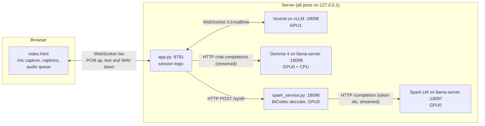
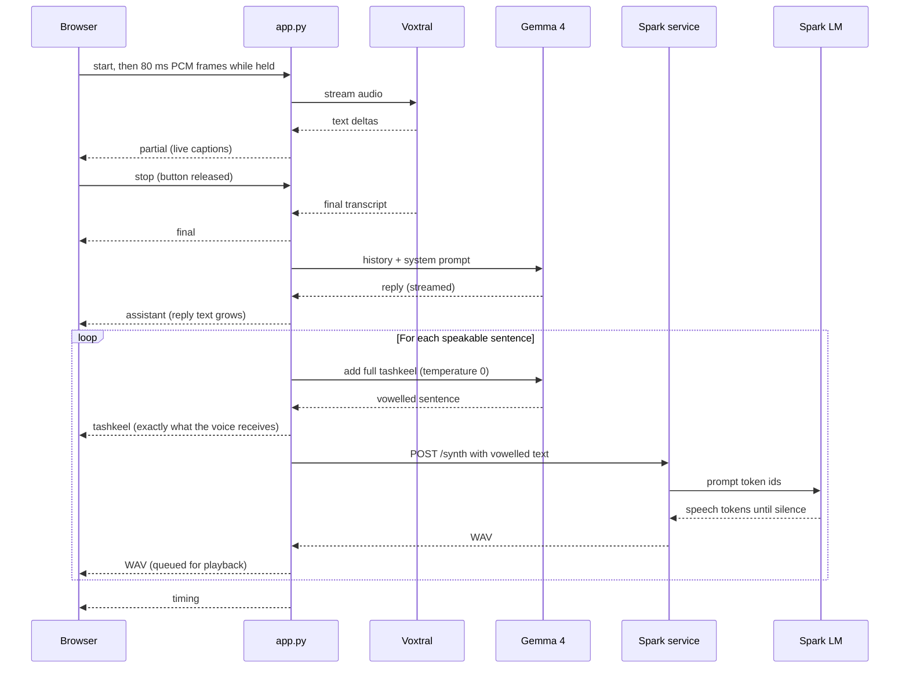

# Shahrazad architecture

Shahrazad is an AI-based speaking tutor. It holds a spoken conversation in Modern Standard Arabic (MSA), corrects the learner's mistakes, and shows and speaks fully vowelled Arabic. Its AI models run locally on one machine, or any of the three parts can run in the cloud instead (see [Cloud parts](#cloud-parts) and [CLOUD.md](CLOUD.md)).

## At a glance

GPU numbers below describe the tested layout of two 12 GB cards. `scripts/configure.py` chooses the placement for other hardware.

| Job | Model | Runtime | Device |
|---|---|---|---|
| Hear the learner | Voxtral Mini 4B Realtime Arabic | vLLM, WebSocket | GPU1 |
| Tutor reply, and adding tashkeel | Gemma 4 26B-A4B QAT + MTP draft head | llama-server | GPU0, with 17 layers of experts on the CPU |
| Generate speech tokens | Arabic-TTS-Spark language model (converted to BF16 GGUF) | llama-server | GPU0 |
| Turn speech tokens into audio | Spark BiCodec decoder | `spark_service.py` (PyTorch) | GPU0 |
| Conversation logic | None | `app.py` (FastAPI) and `tools/` (see [Code layout](#code-layout)) | CPU |
| User interface | None | `index.html` in the browser | Learner's device |

The interaction is push-to-talk with interruption: the learner holds a button or the space bar, and pressing it again while the tutor is speaking stops the reply. It is not full duplex, because the tutor does not listen while it speaks.

## How the parts connect



Each model runs as its own process because their dependencies conflict. Voxtral needs vLLM with PyTorch 2.14, Spark's custom code needs transformers 4.51, and the app needs no PyTorch at all.

## One conversation turn



Each sentence is vowelled and spoken as soon as it is complete, while the rest of the reply is still being written. Gemma has two slots, one for the discussion and one for vowelling, so vowelling doesn't push the discussion out of its cache.

### Text handling between the models

These are in `tools/text.py` and `tools/vowels.py`.

1. `split_sentences` splits the reply and merges one- or two-word fragments forward.
2. `speakable` holds back sentences that are mostly not Arabic. These are shown on screen but not spoken, because the voice only reads Arabic.
3. `clean_text` removes quotes, markdown and any existing vowel marks, and turns "…" into a comma.
4. `vowelize` asks Gemma to add full tashkeel, including case endings.
5. `merge_vowels` keeps the tutor's exact words. A vowelled word is accepted only if its letters match the original; otherwise the original word is kept, without vowels.

### How Spark stops

Spark tends to keep generating silence after the sentence ends. After speech, the token stream is almost entirely tokens 3140, 7645 and 6627. `spark_service.py` stops generation after 25 of these in a row (0.5 s of silence), keeps six for a natural decay, and caps a sentence at 900 tokens (18 s).

### Long turns and long sentences

A Voxtral session holds about 82 s. After 55 s, `StreamEar` in `tools/hearing.py` waits for a pause, or forces it at 72 s, then finishes that session and starts another. Audio arriving meanwhile is held and sent afterwards, and the transcripts are joined.

Spark stops at 18 s per sentence, about 30 words, so vowelled text over 20 words is sent in parts, split at commas where possible.

### How interruption works

Pressing talk stops local playback, and the app cancels the running reply task. A generation counter discards audio that was already in progress. In the end-to-end test, no stale audio arrived after an interruption.

## Subjects, tools and skills

A conversation has a **current subject**: an article or a video. Tools are used only to find one, so ordinary discussion turns have no searching. The subject stays in the system prompt, separate from the chat history, until the learner moves on.

| Part | Where | To add one |
|---|---|---|
| Tools | `tools.yaml`, code in `tools/` | Add an entry. A tool is either a Python function or a tool on any MCP server |
| News outlets | `sources.yaml` | Add its name, the words learners use for it, and its RSS feed |
| Teaching modes | `skills/<name>/SKILL.md` (Agent Skills format) | Add a folder with instructions and `allowed-tools` |

**Finding a subject**

- *Named outlet:* `find_news` reads the outlet's RSS feed. The code matches the outlet's name itself, including when Gemma calls web search instead.
- *Topic:* `web_search` goes through the `donsetch` MCP server.
- *Choosing:* results are a numbered list, and `open_item` takes a number. The model never supplies an address, so it can only open what a search returned.
- *Video:* a pasted YouTube link is detected by the code. `yt-dlp` fetches human-written Arabic captions, or automatic captions if the video's own language is Arabic. Machine-translated tracks are refused, and a video with no Arabic captions is declined.
- *Long videos:* captions are split into sections of about 14,000 characters, and `next_section` moves on.

Tool results go into the system prompt instead of tool-role messages, because Gemma sometimes emits only its thinking marker right after a tool message. Results and subjects are marked as untrusted, and all tools are read-only.

After a subject's first reply, Gemma prepares six questions from it: the main idea, why and what it means, larger ideas to argue about, and the learner's own views. They avoid small details, because the goal is practising Arabic, and where it fits they steer toward the structures this learner gets wrong. Every question, including the broader and personal ones, starts from something specific in the subject, so the discussion doesn't drift. Each turn offers the next one, for once the learner has answered the current question, and it can be adapted to what they just said. If the learner asks a side question, such as what a word means, the tutor answers briefly and returns to the question they were answering. When all six have been used, a fresh set is prepared for the same subject, avoiding the ones already asked and taken from parts of the material not yet discussed, rather than from side topics the talk has moved to. The tutor is told that the next question is how it brings a wandering conversation back to the subject. The questions, the title and the cache warm-up run as their own task after the reply: they used to be cancelled when the learner started talking again, before the questions were ready (about 10 s), so in practice none were prepared and the discussion followed every side topic. In a replay of a real 13-turn video discussion with a restart in the middle, the tutor now came back to the video three times in the last six turns, where before it never did. The subject is saved with the conversation, so it survives a restart.

Opening a subject costs one slow turn, because Gemma has to read it: about 20 s for a 5,000-token video section on the test machine. The spoken "one moment" plays first, and later turns are cached.

## Learner record

Sessions, what was said, and errors by grammar concept are stored locally in `data/learner.db`. After each reply is spoken, Gemma checks what the learner said, so this never delays the conversation.

An error is kept only if its wrong words really appear in what was said. Cards are only for the Arabic language: facts, names, numbers and foreign words never get one. Speech recognition can mishear words but rarely invents a grammar pattern, so word-choice errors in speech don't get cards. Words Gemma judges misheard are dropped, and the learner can remove any card with "That's not what I said".

Each error is matched to a grammar concept in `cards.yaml`, which holds a hand-written one-line reminder and a lesson that opens only when the learner taps "Explain this". For rules the learner has already met, the tutor gives a hint and lets them try again, and gives the correct form if they get it wrong again.

## Sessions and follow-up

Each topic is its own session, saved with its history, subject and list of options. Opening a new subject starts a new session and keeps the old one to return to. The page lists sessions with their turn counts, and reconnecting resumes the latest.

Concepts the learner has got wrong come back on a schedule of 1, 3, 7 and 21 days, moving further out after a success and back after a failure. A follow-up isn't a separate exercise: at most every four turns, the tutor asks a question about whichever topic is active that the answer needs that structure for, without saying it's a review. A focused check then decides whether the learner used it correctly. A concept counts as learned after correct, unprompted use on two different days.

## Level

The learner's level is estimated continuously, with no setup. After each turn of four words or more, Gemma rates what was said, and the estimate moves toward that rating, adjusted for how many errors there were. Saying they don't understand lowers it. Levels only change past a clear margin, so they don't flip back and forth.

The level sets how the tutor speaks, how directly it corrects, and how demanding its questions are. Cards switch to Arabic, with proper grammar terms, for advanced learners. It's stored in `data/learner.db`.

## Models and settings

| Model | Source | Files used | Size | License |
|---|---|---|---|---|
| Voxtral Mini 4B Realtime Arabic | `mistralai/Voxtral-Mini-4B-Realtime-Arabic` | `consolidated.safetensors`, `params.json`, `tekken.json` | 8.25 GB | Apache-2.0 |
| Gemma 4 26B-A4B QAT | `unsloth/gemma-4-26B-A4B-it-qat-GGUF` | `gemma-4-26B-A4B-it-qat-UD-Q4_K_XL.gguf` | 13.3 GB | Apache-2.0 |
| Gemma MTP draft head | Same repository | `MTP/mtp-gemma-4-26B-A4B-it-Q4_0.gguf` | 0.23 GB | Apache-2.0 |
| Arabic-TTS-Spark | `IbrahimSalah/Arabic-TTS-Spark` | `LLM/` (converted), `BiCodec/`, `wav2vec2-large-xlsr-53/`, code and config | 1.0 GB GGUF, 0.6 GB decoder, 1.2 GB wav2vec | Non-commercial (`fair-noncommercial-research-license`) |

| Part | Settings |
|---|---|
| Voxtral | Greedy (temperature 0, fixed by vLLM). `--max-model-len 1024` (82 s per session; longer turns continue in a new session), `--max-num-seqs 1`, `--gpu-memory-utilization 0.91`, PIECEWISE CUDA graphs, `VLLM_USE_FLASHINFER_SAMPLER=0`, `ninja` on `PATH` |
| Gemma, tutor reply | Temperature 1.0, top_p 0.95, top_k 64 (Google's values). Thinking forced off with `--reasoning off` and `enable_thinking: false`. Maximum 300 tokens; last 24 messages of history |
| Gemma, vowelling | Temperature 0, maximum 600 tokens |
| Gemma server | `-c 16384`, KV cache `q8_0`, `--n-cpu-moe 17`, `--spec-type draft-mtp --spec-draft-n-max 4`, `--parallel 2 -kvu --no-cache-idle-slots` |
| Spark language model | BF16 GGUF, `-c 2048`. Temperature 0.8, top_p 0.95, top_k 50 (vendor card), min_p 0, repeat penalty 1.0 |
| Spark voice | No-transcript cloning mode; the reference voice is read once at startup. Output is 16 kHz |

The tutor's system prompt tells Gemma to begin with «نقول: » and the corrected sentence when the learner makes a mistake. It is in `prompts/system.txt`.

In a long conversation that rule sits far back, and the notes added each turn (the next subject question, or a follow-up on an earlier rule that said not to mention the earlier mistake) sometimes won: the tutor answered and asked its question without correcting, and only the underline from the error check showed the mistake. So the private note now ends with a reminder to deal with mistakes first, and the follow-up note says corrections still come first. Replaying a real 24-turn cloud conversation (`run/stage5/naqool_replay.py`, each learner turn with a mistake answered 4–6 times): «نقول» in 49 of 54 replies before, 34 of 36 after; on follow-up turns 30 of 36 before, 36 of 36 after. The one turn still often missed has a subtle error (أكثرهم for a non-human plural), which the separate error check catches.

### Things that are easy to get wrong

- **Convert Spark to BF16, not F16.** The F16 GGUF returns NaN predictions.
- **Force Gemma's thinking off.** llama.cpp enables it by default, which adds 4–12 s and can return empty replies.
- **Give Spark full tashkeel.** It is trained only on vowelled text.
- **Load Spark's service on the CPU first.** The full model does not fit on GPU0 at startup. The service reads the reference voice, drops the language model and wav2vec, then moves only the decoder to the GPU (0.59 GB).
- **Expect occasional startup crashes on this CPU.** Fresh PyTorch processes sometimes die with "Illegal instruction" on this non-AVX2 Xeon, at the first `torch.cos` call. The cause is unknown, and `ATEN_CPU_CAPABILITY` and `MKL_ENABLE_INSTRUCTIONS` did not stop it. `scripts/start.sh` retries up to four times.

## Frontend

The frontend is one static file, `index.html`, with no build step or external libraries. FastAPI serves it at `/`.

- **Microphone:** an inline AudioWorklet downsamples to 16 kHz mono and sends 80 ms frames of PCM16 (1280 samples). Echo cancellation, noise suppression and automatic gain are on.
- **Secure context:** browsers only allow the microphone on HTTPS or `localhost`. The page is reached through a self-signed HTTPS address on the local network, or an SSH tunnel to `localhost:8791`.
- **Controls:** hold the button or the space bar to talk, with a 5-minute limit per turn. "Tap to talk" switches to tap once to start and once to stop. A text box allows typing instead, and "New conversation" starts a fresh one. The talk button shows what the tutor is doing (listening, thinking, speaking), and while it thinks or speaks a Stop button (or Esc) ends the reply.
- **Welcome:** an empty conversation shows a short explanation and three ways to start: just talk, today's news from Al Jazeera, or a YouTube video.
- **Display:** each tutor message is one Arabic line: the vowelled text as each sentence is spoken, and the rest as written until its turn comes. The `tashkeel` message carries the display text and how much of the written reply it covers (`covered`), so the two join without repeating words. "Vowel marks" hides the marks, for reading practice. Sentences the voice can't read (mostly Latin script) stay as written. The time to first audio is shown only with `TUTOR_DEBUG_LOG=1` or `?debug` in the address.
- **Word meanings:** tapping any Arabic word in a reply shows its meaning in that sentence and its dictionary form, from one short brain request (`POST /gloss`), cached in the learner record.
- **Translate:** under each reply, next to Replay. It asks the brain for an English translation (`POST /translate`).
- **Status banner:** the page asks `GET /health` every 20 s. When a local part doesn't answer, or a cloud part has no key, a banner names it, in place of a page that seems frozen. Cloud parts are not called for this, since that would spend credit.
- **Sidebar:** each conversation can be renamed (a chosen name is never replaced by a generated one) or deleted with its corrections. What the learner has practised stays in the record.
- **Exchanges and order:** each exchange (what the learner said, any article or video it opened, and the reply) is one numbered block, #1, #2 and so on, numbered when the server saves it. Each correction card shows the number of the exchange it came from; clicking the number scrolls to that exchange and highlights it. The words each card corrects are underlined in what the learner said, and clicking them brings up the card. The match ignores vowel marks, punctuation and the usual spelling variants (أ إ آ ا, ى ي, ة ه); a correction that can't be found word for word in the transcript is counted next to "You" instead, as a link to its card. Dismissing a card removes its underline. The conversation and the corrections always share one order: newest at the bottom (the default) or at the top. `TUTOR_NEWEST=top` in `.env` sets the default, and the button at the top right changes it for that browser, which remembers the choice.
- **Auto-scroll:** both panes follow new content, including height changes such as the Arabic font loading. Scrolling away to read earlier messages pauses that pane; scrolling back to the newest end, or starting a new exchange, resumes it.
- **Playback:** WAV sentences are queued with the Web Audio API so they play back to back. Each tutor message has a Replay button, which speaks it again from its saved vowelled text. "Slower voice" plays at 0.8× through audio elements instead, which keep the pitch.
- **Progress:** "Progress and all corrections" in the sidebar shows the estimated level, the rules being practised (with those due for a follow-up marked) and those learned, and every correction card across conversations, each with its lesson and a link back to its exchange (`GET /progress`). `GET /cards.csv` exports the cards for flashcard apps such as Anki: front, back, tags.
- **Login:** with `TUTOR_PASSWORD` set, every route except `/login` and `/assets` needs a signed cookie (HMAC-SHA256 with a per-install secret in `data/.cookie_secret` and the password, valid 30 days, HttpOnly, SameSite=Strict). The WebSocket checks the same cookie, and always checks that a browser's `Origin` is the tutor's own address.
- **Per-browser choices:** the order, tap to talk, slower voice and vowel marks are remembered by each browser.

### WebSocket protocol (`/ws`)

| Direction | Message | Meaning |
|---|---|---|
| Browser to server | `{"type":"start"}` | The learner started talking |
| Browser to server | Binary | 80 ms of PCM16 at 16 kHz |
| Browser to server | `{"type":"stop"}` | The learner stopped talking |
| Browser to server | `{"type":"text","text":…}` | Typed message |
| Browser to server | `{"type":"reset"}` | Start a new conversation |
| Browser to server | `{"type":"switch","id":…}` | Open a saved conversation |
| Browser to server | `{"type":"rename","id":…,"title":…}` | Rename a conversation |
| Browser to server | `{"type":"delete","id":…}` | Delete a conversation and its corrections |
| Browser to server | `{"type":"cancel"}` | Stop the reply (the Stop button) |
| Browser to server | `{"type":"dismiss","id":…}` | Remove a correction the learner didn't make |
| Server to browser | `partial` | Live transcript so far |
| Server to browser | `final` | Final transcript |
| Server to browser | `assistant` | Reply text so far |
| Server to browser | `tashkeel` | Vowelled text spoken so far (`text`), the reply as displayed (`display`) and how much of the written reply it covers (`covered`) |
| Server to browser | `text_only` | A sentence was shown but not spoken |
| Server to browser | `timing` | Stage timings for the turn |
| Server to browser | `turn` | The saved turn's id, used by Replay, and its number in the session (`n`) |
| Browser to server | `{"type":"replay","turn":id}` | Speak a saved reply again |
| Server to browser | `error` | Error message for the status line |
| Server to browser | Binary | One WAV sentence |

## Cloud parts

Each of the three parts (brain, hearing, voice) is set to `local` or `cloud` in `.env`, independently. `tools/providers.py` is the only module that reads these settings; everything else builds the same llama.cpp-style requests either way.

| Part | Local path | Cloud path (OpenRouter) |
|---|---|---|
| Brain | `http://127.0.0.1:18099/v1/chat/completions` | `/api/v1/chat/completions`, the same Gemma 4 26B-A4B, limited to providers that return valid structured output. `llm_body()` only drops llama-server's own fields and names the model and providers, so the tutor behaves as it does locally |
| Hearing | Voxtral WebSocket, streamed, with live captions and the 55 s session rollover (`StreamEar`) | `ClipEar` cuts the turn into segments at pauses. Each finished segment is transcribed once at `/api/v1/audio/transcriptions`; the unfinished one is re-transcribed every 1.5 s for live captions |
| Voice | `POST /synth` on `spark_service.py`, WAV | `/api/v1/audio/speech`, Grok Voice Ara, MP3. The browser's `decodeAudioData` plays either |

`scripts/start.sh` starts only the local processes that are needed. `scripts/configure.py` plans GPU placement for the local parts only, and when they don't fit it names the fewest parts to move, in this order: hearing first (the most GPU memory for little cost), then the brain, then the voice. `install.sh` skips the environments, llama.cpp build and model downloads that cloud parts don't need. Measurements and costs are in [CLOUD.md](CLOUD.md).

## Code layout

Each module does one job, and the choice between local and cloud parts is made once, in `tools/providers.py`, from a table of parts. The rest of the code calls the same functions whatever runs each part.

| Module | Job |
|---|---|
| `app.py` | The web routes, login, and `Session`: one learner's conversation, from a heard turn to the spoken reply, the topic and the follow-ups |
| `tools/providers.py` | Reads the part settings. `PARTS` names each part's model and health check; `transcribe()` and `synth()` pick the local or cloud service from a table, and `llm_body()` adapts brain requests for the cloud |
| `tools/brain.py` | Every brain request: `ask`, `ask_json` (structured, retried once), `turn` (the streamed discussion with tool calls) and `warm` (cache warm-up). It owns the two llama-server slots |
| `tools/hearing.py` | One turn's hearing behind one interface (`start`, `add`, `finish`, `close`): `StreamEar` for Voxtral, `ClipEar` for the cloud. `listen()` makes the one set in `.env` |
| `tools/text.py`, `tools/vowels.py` | Sentence splitting and cleaning; vowelling and the checks that keep the tutor's own words |
| `tools/learner.py` | The learner record (SQLite), error finding and the review schedule |
| `tools/subjects.py`, `tools/youtube.py`, `tools/registry.py`, `tools/skills.py` | Topics: news, articles and videos, and the tools and skills the brain can use |
| `spark_service.py` | Small local service for Spark's decoder, in its own Python environment |

## Hardware and performance

Measured on an HP Z820 with two RTX 3060 12 GB cards, 125 GB RAM and a Xeon E5-2687W v2 (no AVX2). Timing comes from an end-to-end test using synthetic speech over the real WebSocket, 10 turns.

| Measure | Result |
|---|---|
| Time from end of speech to first audio | 5.0 s median, 4.6–6.3 s; 8.0 s on the first turn |
| The same, November 2026, five spoken turns with corrections and longer replies | 6.8 s on the first turn, 7.2–9.3 s after (median 8.6 s). Gemma reads its new prompt for 1.7–3 s before the first word, because part of it runs on the CPU |
| Transcript ready | 0.75 s |
| Reply complete | about 1.6 s after end of speech |
| Vowelling the first sentence | about 2.1 s |
| Spark for the first sentence | about 1.2 s |
| GPU memory free with everything running | GPU0 about 600 MiB, GPU1 about 1050 MiB |

| Quality check | Result |
|---|---|
| Voxtral on human MSA | 0.12 % character error on 12 clips, 0.24 % on 20 clips by an earlier method |
| Gemma vowelling, 40 MSA paragraphs of SadeedDiac-25 | 2.1 % case-ending errors, 4.5 % word errors, ignoring sukun. 3 paragraphs had changed letters and are excluded |
| Tutor corrections, 7 error types | 6 of 7 caught in a text-only test; 5 of 7 right through the full chain with synthetic speech |
| Blind listening, 12 sentences with grammar-dependent endings | Spark marked wrong on 0 or 1, the earlier Habibi voice on 9 |

### Smaller hearing tried: Audar-ASR-V1-Turbo (November 2026, removed)

Measured on 60 human MSA clips from the Habibi benchmark and 34 learner sentences spoken by the tutor's voice, one clip at a time on a 12 GB card:

| Model | Character error, human clips | Clips with no error | Learner mistakes written as said | GPU memory |
|---|---|---|---|---|
| Voxtral Mini 4B Realtime Arabic | 1.40 % | 44 of 60 | 9 of 20 | 10.8 GB (vLLM) |
| Audar-ASR-V1-Turbo | 0.74 % | 53 of 60 | 8 of 20 | 4.5 GB |
| Audar-ASR-V1-Flash | 3.4 % | 30 of 60 | 7 of 20 | 1.5 GB |
| Qwen3-ASR 1.7B | 4.0 % | 31 of 60 | 8 of 20 | 3.9 GB |
| Qwen3-ASR 0.6B | 5.7 % | 18 of 60 | 8 of 20 | 1.5 GB |

With Audar on GPU1, Gemma could be split over both cards (3 expert layers on the CPU instead of 17), and first audio in the five-turn spoken eval fell from a median of 7.8 s to 5.7 s. In a live test with a real microphone, though, Audar reacted to background noise and sometimes wrote words that weren't said (the test clips above are clean). It was briefly an option, then removed, since a second local hearing path made setup more complex for a model that wasn't the default. A voice-activity filter in front of a clip model might make it worth another look.

## Adapting to other hardware

`scripts/configure.py` detects the NVIDIA GPUs and system memory, or previews other hardware with `--gpus` and `--ram`. It tries every placement of the three GPU workloads, keeps the one that leaves the most of Gemma on the GPU, and writes `GPU_ASR`, `GPU_LLM`, `GPU_VOICE`, `GEMMA_CPU_MOE` and `VOXTRAL_GPU_FRACTION` to `.env`.

| Workload | GPU memory | Can it shrink? |
|---|---|---|
| Voxtral with 82 s sessions | 10.85 GB | No, it needs one card with about 11.4 GB free |
| Spark language model and decoder | 2.1 GB | No |
| Gemma 4 26B-A4B + draft head | 14.9 GB with everything on the GPU | Yes, 409 MB less per layer moved to the CPU, down to 2.6 GB at 30 layers |

The planner keeps 650 MB free on each GPU in use and allows for a desktop on the GPU driving a monitor. System memory use was measured at about 17 GB at 16 layers, and each extra layer on the CPU adds about 0.4 GB.

Gemma's speed depends on the CPU as layers move there. On the test machine it ran at 46 tokens/s with 10 layers on the CPU, 43 with 14, 34 with 22 and 28 with 30. Only the two-card layout has been run end to end; the others are calculated from these measurements.

## Running it

```bash
scripts/start.sh     # starts all five processes, each with an 8-hour limit
scripts/stop.sh      # stops them
```

From another device, run `./install.sh --lan` to enable HTTPS, because browsers only allow the microphone on HTTPS or `localhost`. Alternatively, open a tunnel and visit `http://localhost:8791`:

```bash
ssh -L 8791:127.0.0.1:8791 <user>@<server>
```

The tutor needs both GPUs, so other GPU workloads have to be stopped first.

## Current limits

- The tutor is push-to-talk, not full duplex.
- Explanations in other languages are text only.
- Every hearing model tested sometimes writes a learner's mistake as correct Arabic, which hides it from the tutor. On 20 mistakes spoken by the tutor's own voice, Voxtral kept 9 and Audar-ASR-V1-Turbo 8 (some were likely corrected by the vowelling before the voice). Not yet measured on real learners.
- About 1 word in 50 can still get a wrong ending from Gemma's vowelling, and Spark reads what it is given.
- Gemma can still make grammar errors of its own.
- The possessive-phrase (إضافة) correction is unreliable.
- There are no user accounts. `TUTOR_PASSWORD` sets one shared login; conversations, errors and progress are saved in one local learner record, so everyone using the same server shares it.

See [ROADMAP.md](ROADMAP.md) for what comes next.
